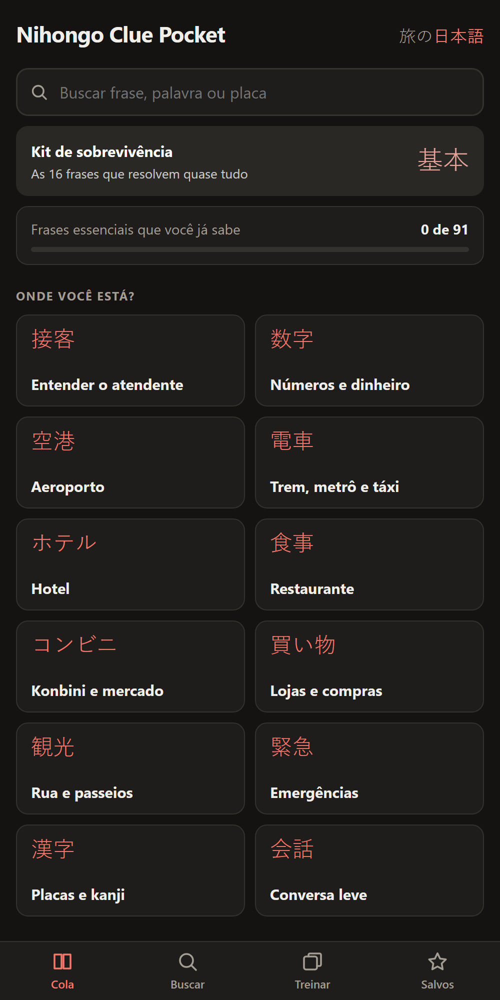
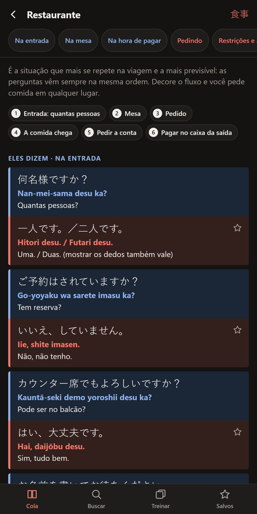
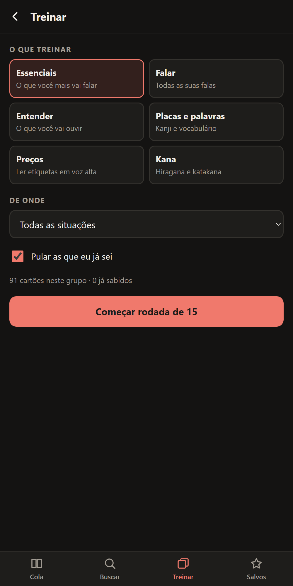
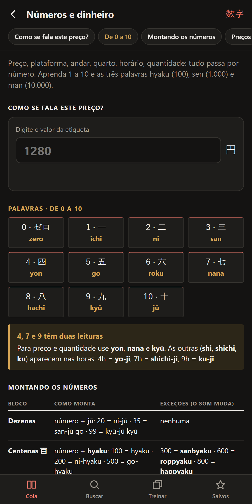
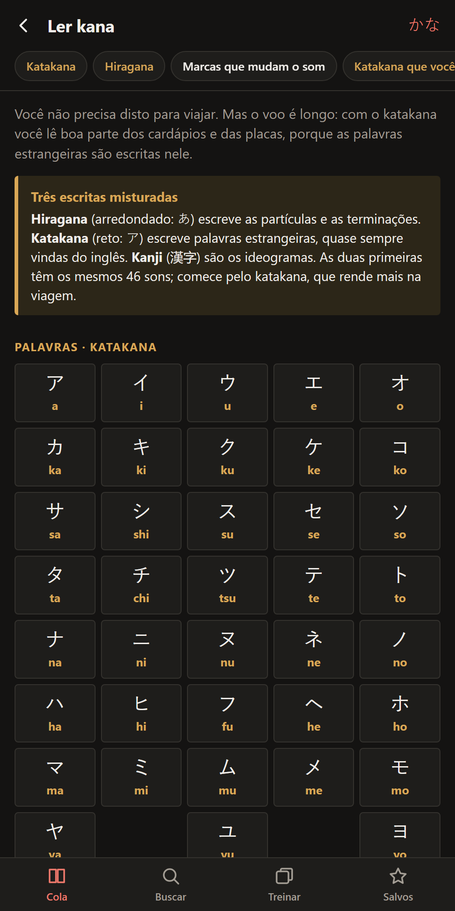
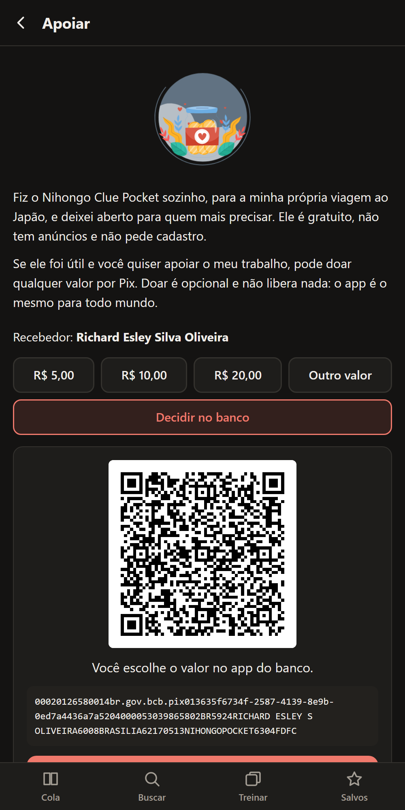

<div align="center">


# Nihongo Pocket

**旅の日本語 · Cola de bolso de japonês para viagem**

O que eles dizem, o que você responde e como ler as placas.<br>
Feito para o celular, funciona sem internet e abre na hora.

[](https://nihongo-pocket-ivory.vercel.app)

[](https://github.com/RDEsley/NihongoCluePocket/actions/workflows/ci.yml)


[](LICENSE)

</div>

<br>

<div align="center">
<table>
  <tr>
    <td></td>
    <td></td>
    <td></td>
  </tr>
  <tr>
    <td align="center"><sub>Situações da viagem</sub></td>
    <td align="center"><sub>Eles dizem, você responde</sub></td>
    <td align="center"><sub>Treino em rodadas</sub></td>
  </tr>
  <tr>
    <td></td>
    <td></td>
    <td></td>
  </tr>
  <tr>
    <td align="center"><sub>Leitor de preços</sub></td>
    <td align="center"><sub>Kana para o voo</sub></td>
    <td align="center"><sub>Apoio por Pix, sem servidor</sub></td>
  </tr>
</table>
</div>

## Por que existe

Fiz este app para a minha própria viagem ao Japão. Eu tinha um guia de estudo em PDF, bom de ler em casa e ruim de usar no balcão de uma loja, com o atendente esperando. Queria três coisas que o PDF não dava:

- **achar a frase em segundos**, pela situação ou digitando uma palavra;
- **mostrar a tela ao atendente**, com o japonês bem grande, quando a pronúncia não saísse;
- **estudar no voo**, sem internet, em rodadas curtas.

O foco não é aprender japonês. É conseguir viajar.

## O que ele faz

| | |
| --- | --- |
| **13 situações** | Aeroporto, trem, hotel, restaurante, konbini, lojas, rua, emergências e mais, na ordem em que a viagem acontece. |
| **Duas cores, dois papéis** | Azul é o que você vai **ouvir**; vermelho é o que você **diz**. Cada fala do atendente já vem com a sua resposta ou com o que fazer. |
| **Busca** | Em português, rōmaji ou japonês, ignorando acentos e hifens: `banheiro`, `sumimasen`, `出口`. |
| **Tela cheia** | Um toque abre a frase em letras grandes para mostrar a alguém, com áudio e botão de salvar. |
| **Leitor de preços** | Digite `3980` e leia `sanzen kyū-hyaku hachi-jū en`, com as exceções de som (sanbyaku, roppyaku, hassen). |
| **Treinar** | Rodadas de 15 cartões em seis modos: essenciais, falar, entender, placas, preços sorteados e kana. O que você erra volta até acertar. |
| **Prática de diálogo** | Nos diálogos modelo, esconda as suas falas e tente responder antes de revelar. |
| **Kana** | Tabelas de hiragana e katakana e as palavras em katakana que aparecem em todo cardápio. |
| **Offline de verdade** | Depois da primeira visita, tudo abre sem rede. Instala na tela inicial como um app. |

## Como foi construído

HTML, CSS e JavaScript puros. Sem framework, sem etapa de build e sem nenhuma dependência em produção. A escolha é proposital: o app precisa abrir rápido num celular com sinal ruim, caber inteiro no cache offline e continuar funcionando daqui a anos sem manutenção de pacotes.

- **Conteúdo como dados.** Todas as frases vivem em [`js/data.js`](js/data.js), em uma estrutura única que alimenta as telas, a busca e os cartões de treino. Acrescentar uma frase é acrescentar uma linha.
- **Offline primeiro.** O [service worker](sw.js) pré-carrega tudo na instalação e responde do cache na hora, atualizando em segundo plano quando há rede.
- **Sem servidor e sem conta.** Favoritos e progresso ficam no `localStorage` do aparelho. Não há login, analytics, cookies nem requisições externas; as fontes são as do sistema.
- **Áudio do aparelho.** A pronúncia usa a Web Speech API com a voz japonesa já instalada no celular, então não há arquivos de áudio para baixar.
- **Pix sem intermediário.** A tela de apoio monta o código "Pix Copia e Cola" (BR Code estático, padrão EMV do Banco Central) e o QR Code no próprio navegador. O app não sabe se alguém doou.
- **Acessível e adaptável.** Tema claro e escuro pelo sistema, foco visível, alvos de toque grandes, navegação por teclado e respeito a `prefers-reduced-motion`.

## Estrutura

```text
.
├── index.html              casca do app e barra de navegação
├── sw.js                   cache offline (suba CACHE a cada mudança)
├── manifest.webmanifest    instalação como app
├── css/styles.css          tema claro e escuro por variáveis
├── js/
│   ├── data.js             todo o conteúdo (situações, frases, placas, kana)
│   ├── app.js              rotas, telas, busca, treino, tela cheia, áudio
│   ├── pix.js              BR Code do Pix e configuração da doação
│   └── legal.js            termos de uso e política de privacidade
├── vendor/                 qrcode-generator (MIT), carregado só na tela de apoio
├── icons/                  ícones do app
├── tests/                  testes do Pix, do conteúdo e do leitor de preços
└── docs/screenshots/       imagens deste README
```

## Rodando localmente

Não há nada para instalar. Qualquer servidor estático serve:

```bash
git clone https://github.com/RDEsley/NihongoCluePocket.git
cd NihongoCluePocket
npm start          # sobe em http://localhost:4173
```

Abra no navegador em largura de celular. O service worker só registra em HTTPS, então o modo offline é testado no deploy.

## Testes

```bash
npm test           # node --test, sem dependências
npm run check      # sintaxe de todos os scripts
```

Os testes cobrem o que não pode quebrar em silêncio:

- **Pix:** CRC16 contra o vetor padrão, o exemplo oficial do Banco Central reproduzido caractere a caractere, os campos do código deste projeto e a leitura do valor digitado (`15,50` vale, `1.500` é recusado para nunca virar outro valor).
- **Conteúdo:** toda frase tem japonês e rōmaji, não há caracteres corrompidos vindos de PDF e as tabelas de kana têm as 46 letras.
- **Leitor de preços:** todos os exemplos do guia de estudo.
- **Offline:** todo arquivo que a página carrega está na lista de pré-cache.

O QR Code também foi conferido de ponta a ponta: renderizado na tela, capturado e decodificado, com resultado idêntico ao código exibido.

## Instalando no celular

1. Abra [nihongo-pocket-ivory.vercel.app](https://nihongo-pocket-ivory.vercel.app) no Chrome (Android) ou no Safari (iPhone).
2. Toque em **Instalar** na tela inicial do app, ou no menu do navegador escolha **Adicionar à tela inicial**.
3. Abra uma vez com internet. A partir daí funciona em modo avião.

Para o áudio, o aparelho precisa ter uma voz japonesa. No Android ela é baixada em Configurações → Conversão de texto em voz.

## Privacidade

Nenhum dado pessoal é coletado. O que você salva fica só no seu aparelho. Os detalhes estão na política de privacidade e nos termos de uso, dentro do próprio app.

## Apoiar

O app é gratuito e vai continuar assim. Se ele ajudou na sua viagem, há uma tela de apoio por Pix no rodapé da tela inicial. Doar é opcional e não libera nada.

## Licença

[MIT](LICENSE) © Richard Oliveira. O QR Code usa [qrcode-generator](https://github.com/kazuhikoarase/qrcode-generator), de Kazuhiko Arase (MIT).

<div align="center">
<br>
<sub>Feito em Brasília para ser usado em Tóquio. いってきます！</sub>
</div>
